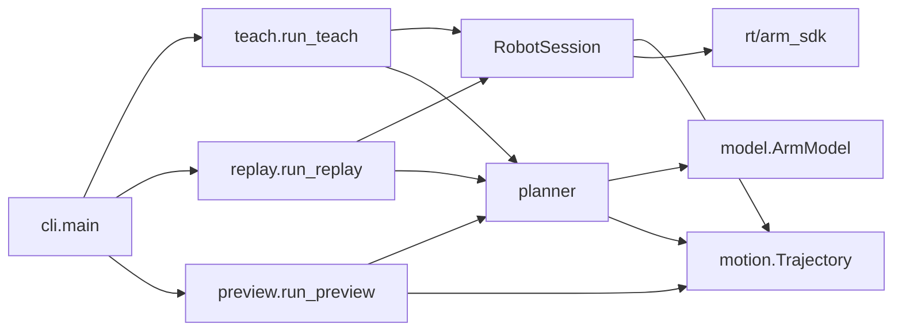

# SPEC：G1 Action Studio 上肢示教与动作回放重写

来源：[PRD](prd-project-rebuild.md)。日期：2026-10-16。参考工作树：main / 0ff1683，包含未提交变更。本文是待实施技术合同，不表示新代码已经存在或经过真机验证。

覆盖 US-001–US-007、FR-1–FR-18。实现按本文从空包重写，旧源码、旧命令、旧 side 格式及 v1/v2 文件均不兼容。

## 1. 技术选择与边界

| 项目 | 决定 | 原因 |
| --- | --- | --- |
| 控制对象 | 三自由度腰的 G1 29DoF Arm7，上肢 17 关节。 | 支持单臂、双臂、双臂加腰；不控制腿。 |
| 控制通道 | rt/lowstate 反馈，rt/arm_sdk 发布 HG 消息。 | 保留厂商运控，不使用全身 rt/lowcmd。 |
| 动作文件 | group + frames[{t,q}]。 | 时间与实测位置就是回放源数据，不保存派生速度与说明字段。 |
| 内部轨迹 | 统一上肢 17 维，PPoly 同时求 q 和 dq。 | 规划、预览、发送使用同一曲线。 |
| 动作插值 | SciPy CubicSpline，整段首尾速度为零。 | 不手写求解器，不在每个采样点停顿。 |
| 避碰衔接 | 先直连，再 OMPL RRTConnect，有效删点后按折线安排五次时间函数。 | 保留几何路径，允许绕行拐点停顿。 |
| 执行 | 一个 RobotSession、一个发送线程。 | 四个 group 不产生四套执行器。 |
| 应用线程 | 主线程编排/规划，发送线程，终端输入线程。 | 规划期间持续发送，退出能回收输入。 |

没有数据库、HTTP API、服务端或插件注册中心。文件格式与 Python 函数是本项目接口。灵巧手、锁腰机型、全身平衡、旧版适配均不在实现范围。

## 2. 目录与依赖方向

```text
src/g1_action_studio/
├── __init__.py
├── __main__.py
├── cli.py        # argparse、配置读取、输入事件、命令分发
├── motion.py     # Action、StartPose、文件读写、Trajectory和时间函数
├── model.py      # 唯一关节/分组映射、MuJoCo几何
├── planner.py    # 按活动组找路、曲线检测、序列构建
├── robot.py      # SDK、反馈记录、报文、RobotSession和唯一发送循环
├── teach.py      # 示教与返回的顺序编排
├── replay.py     # 单/多动作的一套回放编排
├── preview.py    # 同一模型与轨迹的查看器
└── resources/
    ├── g1_29dof.xml
    ├── ORIGIN.md
    └── meshes/
```

model 顶层只加载标准库和轻量映射；创建模型才导入 MuJoCo。motion 可导入 model 的分组映射，model 不反向导入 motion。曲线碰撞检测放 planner，避免循环依赖。

robot 只在实际连接或明确的报文构造调用中导入 SDK；导入模块本身不初始化 DDS。planner 不导入 robot，robot 不调用 planner。teach/replay 直接编排实际对象，不再设 Port、Service、Manager、Repository 或 SDK 包装层。



Python 维持 >=3.11；普通依赖新增 NumPy（>=1.26,<3）和 SciPy（>=1.16.3,<1.17）。planning 沿用 MuJoCo >=3.15,<4 与 Linux OMPL ==2.0.1。精确解析结果进入 uv.lock，不附带升级其他依赖。测试沿用 unittest，Ruff 规则沿用当前项目。

完整规划、终端设备会话和图形预览以 Linux 为交付平台。Windows 支持文件及数值测试，终端事件用测试输入替换，不增加第二套设备实现。

## 3. 关节、数据与文件合同

### 3.1 唯一关节顺序

所有角度为 rad，速度为 rad/s，时间为秒。model.py 只维护一张有序关节表，条目含模型关节名与 SDK 槽位；分组、名字列表和槽位列表从它派生，不手写多份排列。

| upper_q 下标 | 物理关节顺序 | SDK 槽位 |
| --- | --- | --- |
| 0–6 | 左肩 Pitch、Roll、Yaw，肘，腕 Roll、Pitch、Yaw。 | J15–J21。 |
| 7–13 | 右侧同序。 | J22–J28。 |
| 14–16 | 腰 Yaw、Roll、Pitch。 | J12、J13、J14。 |

因此 UPPER_SLOTS 的唯一顺序是 (15,16,17,18,19,20,21,22,23,24,25,26,27,28,12,13,14)。J29.q 为控制权重，永不放入 q、dq、关节限位或碰撞模型。

| group | upper_q 活动下标 | 文件每帧维数 |
| --- | --- | --- |
| left_arm | 0–6 | 7 |
| right_arm | 7–13 | 7 |
| arms | 0–13 | 14 |
| arms_waist | 0–16 | 17 |

leg_q 按左腿六关节、右腿六关节排列，对应 SDK J0–J11。它只用于模型上下文，不用于本工具的腿部控制报文。

### 3.2 三个数据对象

| 对象 | 字段与形状 | 不变量 |
| --- | --- | --- |
| Action | group；t: float64[N]；q: float64[N,K]。 | N>=2；K由group决定；t[0]=0且递增；数组加载后只读。 |
| StartPose | leg_q: float64[12]；upper_q: float64[17]。 | 一次会话只固定一份启动值。 |
| Trajectory | 一个 PPoly；duration；精确首末目标。 | 所有区间输出17维；不再携带schema、profile或资格状态。 |

Feedback 是 robot 内部的“主机 monotonic_ns 接收时间 + StartPose 快照”，不是另一种落盘格式。无需复制未被消费的速度、电流、模式、诊断与报文全量数据。

Trajectory.sample(t) -> (q17,dq17)：区间内同时计算多项式及一阶导数；t<=0 或 t>=duration 返回精确端点与零速度。内部连接边界选后一段，整个序列的最后端点单独保留。不向区间外外推。

### 3.3 文件与一次读取边界

动作 JSON 精确为：

```json
{
  "group": "left_arm",
  "frames": [
    {"t": 0.0, "q": [0.0, 0.2, 0.0, 0.8, 0.0, 0.0, 0.0]},
    {"t": 0.02, "q": [0.01, 0.2, 0.0, 0.81, 0.0, 0.0, 0.0]}
  ]
}
```

其他三个 group 只改变 group 值和 K，结构不变。group/frames、每帧 t/q 以外的键直接作为不支持格式报错，不探测版本或尝试转换。

load_action 一次读取、检查上述形状、数值有限、时间顺序，再构造 Action。布尔值不当作数值。之后 action_curve、序列拼接、发送不重复验证文件。不是在各层重新调用 validate_frames。

save_action 只写上述字段，UTF-8、JSON数字、换行结尾；输出路径由命令指定，采用独占创建，已有文件返回 FileExistsError，不覆盖、不加 force 分支。不创建 recording、plan、report 中间文件。

启动 JSON 精确为 leg_q[12] 与 upper_q[17]，没有 body_q、arm_q 或重复的腰数据。实际设备启动值从同一条 LowState 的 J0–J28 映射读取，不读取离线起点文件。

增益 JSON 精确为以下两个对象，各含四个值：

```json
{
  "arms": {"hold_kp": 60.0, "hold_kd": 1.5, "teach_kp": 20.0, "teach_kd": 1.5},
  "waist": {"hold_kp": 60.0, "hold_kd": 1.5, "teach_kp": 20.0, "teach_kd": 1.5}
}
```

cli.load_gains 一次解析八个非负有限数；不设置通用安全范围、参数联动门槛或资格标签。示例值仅表示结构。实际 kp/kd 向量由 RobotSession 根据阶段与 group 生成。

## 4. 公开调用接口

下表是模块内直接使用的 Python 合同，不是待建设的抽象接口层。数值数组由内部代码保证维度，不在每个函数重复审计。

| 模块 | 接口 | 输出/职责 |
| --- | --- | --- |
| cli | main(argv=None) -> int | 唯一入口，解析参数、创建取消事件、分发并映射退出码。 |
| cli | load_gains(path) | 两组八个增益值。 |
| motion | load_action(path) -> Action | 一次读取新格式。 |
| motion | save_action(action,path) -> None | 独占写入精简动作。 |
| motion | load_start(path) -> StartPose | 离线启动姿态。 |
| motion | action_curve(action,start_upper,speed) -> Trajectory | 展开17维并构造动作曲线。 |
| motion | connection_curve(points17,seconds) -> Trajectory或None | 已规划折线的时间函数；全零长度返回None。 |
| motion | concatenate(parts) -> Trajectory | 拼接同一PPoly表示；忽略None连接。 |
| model | ArmModel(leg_q) | 加载资源并固定腿上下文。 |
| model | ArmModel.valid(upper_q) -> bool | 模型关节范围及几何接触判定。 |
| model | ArmModel.edge_free(a,b,cancel) -> bool | 对真实线段加密检测，规划取消时终止。 |
| planner | connect(model,a,b,active_groups,seconds,cancel) | 直连或搜索，返回连接轨迹或None。 |
| planner | check_trajectory(model,trajectory,cancel) -> None | 对实际曲线检测；失败抛PlanningError。 |
| planner | plan_sequence(actions,start,model,speed,transition_seconds,cancel) -> Trajectory | 构造进入、各动作、各过渡、返回。 |
| robot | build_command(q,dq,kp,kd,weight,crc) -> LowCmd_ | 唯一17维到35槽报文构造，crc是官方CRC实例。 |
| teach | run_teach(interface,group,gains,output,transition_seconds,cancel) -> None | 一次完整示教会话。 |
| replay | run_replay(interface,actions,gains,speed,transition_seconds,cancel) -> None | 单动作与多动作共用入口。 |
| preview | run_preview(actions,start,speed,transition_seconds,cancel) -> None | 同一规划结果进入查看器。 |

RobotSession(interface,gains,cancel) 支持 with，其方法固定如下：

| 成员 | 合同 |
| --- | --- |
| start_pose | 进入会话取得的启动 StartPose。 |
| acquire() | 唯一发送线程渐变接管，阶段发送完成后返回。 |
| follow(group) | 所选关节跟随反馈，渐变到各自teach增益；完成渐变后返回并继续跟随。 |
| begin_recording() | 清空缓冲，记录已选group；下一条真实反馈开始入样本。 |
| end_recording() -> (Action,frozen_upper_q) | 同一临界区结束记录、关闭跟随、冻结终点；保持原增益。 |
| hold() | 固定目标不变，渐变恢复各自hold增益，完成后返回。 |
| play(trajectory) | 提交完整曲线；精确最后目标成功Write后返回并保持终点。 |
| close() | 共用交回并回收发送线程、通道；幂等。 |

begin_recording 不重复传 group；build_command 不解释 group；play 不再读取文件或规划；close 不发起回家运动。

### CLI 合同

| 命令 | 必需参数 | 可选轨迹参数 |
| --- | --- | --- |
| teach | --interface、--group、--config、--output、--execute。 | --transition-seconds，默认2。 |
| replay | 一个或多个动作路径、--interface、--config、--execute。 | --speed默认1；--transition-seconds默认2。 |
| preview | 一个或多个动作路径、--start。 | 同replay；不要求增益配置或网卡。 |

speed 与 transition-seconds 在 argparse 入口解析为正的有限数，不设置最大阈值。缺少 execute 在连接设备前作为用法错误返回；不把 teach/replay 变成预检命令。旧 --side、--profile、build、transition、preflight、audit 不保留别名或迁移入口。

```bash
g1-action-studio teach --interface eth0 --group left_arm --config config.json --output left.json --execute
g1-action-studio teach --interface eth0 --group right_arm --config config.json --output right.json --execute
g1-action-studio teach --interface eth0 --group arms --config config.json --output arms.json --execute
g1-action-studio teach --interface eth0 --group arms_waist --config config.json --output upper.json --execute
g1-action-studio preview upper.json left.json --start start.json
g1-action-studio replay upper.json left.json --interface eth0 --config config.json --execute
```

## 5. 轨迹、规划与完整调用流程

### 5.1 从任意group展开为17维

设启动上肢为 home，group 对应下标集合 I。每个动作样本先复制 home，再令 full_q[I]=action.q。非选关节的位置始终为 home，导数始终为零。

action_curve 直接对时间 t/speed 和 full_q 构造 CubicSpline(axis=0,bc_type="clamped",extrapolate=False)。因此时长为 t[-1]/speed，导数自动具有正确倍率，不在发送端再乘一次 speed。只限制整段两端速度为零，内部不是每帧停顿。[SciPy合同](https://docs.scipy.org/doc/scipy/reference/generated/scipy.interpolate.CubicSpline.html)

三次动作段和五次连接段统一为 PPoly：三次系数在最高两阶补零，统一存为 shape(6,intervals,17)。拼接只平移时间断点、拼系数，不重新拟合位置；去除重复边界时间，保留局部幂基系数不变。由一个 PPoly(t)和PPoly(t,1)同时生成目标。[PPoly合同](https://docs.scipy.org/doc/scipy/reference/generated/scipy.interpolate.PPoly.html)

### 5.2 按活动范围连接

- 启动→A：active_groups={A.group}。
- A→B：active_groups={A.group,B.group}，取两者下标并集。
- 最后动作→启动：active_groups={最后group}。

搜索只建立这些活动维度，完整姿态的其余位置固定为 home。不能比较端点后把“角度相同”的选中关节排除，它仍可能参与绕障；也不能为单臂失败自动放开17维。

connect 的步骤：

1. 先对起终点进行本模型几何/范围判定；重合且有效时返回None，不消耗连接时间。
2. edge_free 判定直连；可行则采用两点折线。
3. 否则在活动维度的 XML range 内建立 OMPL RealVectorStateSpace，固定其余维度，使用 RRTConnect。
4. 搜索预算为每段5秒，或cancel提前结束；这是算法终止条件，不是播放状态超时。只接受精确解，近似解不得冒充到达目标。
5. 使用保持有效的快捷删点，采用与直连相同的状态/线段判定；不追加B样条空间平滑。删点预算最多1秒并可取消。[OMPL依据](https://ompl.kavrakilab.org/classompl_1_1geometric_1_1PathSimplifier.html)
6. 删除连续重复路点，connection_curve按折线生成时间函数。

对第i段，L_i=||p[i+1]-p[i]||₂，T_i=T*L_i/ΣL。令u=局部时间/T_i，h=10u³-15u⁴+6u⁵，则q=p_i+hΔp，dq=30u²(1-u)²Δp/T_i。空间仍在原线段，折点q/dq连续且速度为零。一个连接的所有折线段总耗时为transition-seconds。

### 5.3 动态腰几何与帧间检测

模型资源取官方unitree_mujoco的g1_29dof.xml及其网格。采用其模型历史中ab03eec提交对应版本，取资产时将解析出的完整SHA和许可写入ORIGIN.md；不运行时联网取模型，不使用旧Dex3 XML作为替代。[资源](https://github.com/unitreerobotics/unitree_mujoco/blob/main/unitree_robots/g1/g1_29dof.xml)、[模型历史](https://github.com/unitreerobotics/unitree_mujoco/commits/main/unitree_robots/g1/g1_29dof.xml)

按关节名取得MuJoCo joint与qpos地址，不能把SDK槽位直接当qpos下标；free base保留资源初始位置与单位四元数。每次写入leg_q[12]和upper_q[17]再做mj_forward。模型与查看器分别持有自己的MjData，规划中不与图形线程共享可变数据。

碰撞采用模型实际碰撞geoms和MuJoCo contact结果，遵从XML碰撞掩码及装配排除，忽略纯显示副本。按祖先关节标记受17个上肢关节影响的geoms，保留至少一端带标记的接触对；腰下游躯干、头部、双臂均在内，腿虽固定仍是碰撞对象。非排除对的接触距离<=0即判碰撞，不另设clearance配置。

规划角分辨率固定为0.02rad，只用于几何采样：线段取N=max(1,ceil(||b-a||∞/0.02))并包含两端。曲线按每个多项式区间分别求最大绝对速度M：检查区间端点和加速度多项式实根处，取N=max(1,ceil(M*Δt/0.02))，在真实曲线上均分采样。覆盖全部原始knots和连接折点，不能只看两端差值。

check_trajectory 对最终组合曲线执行上述采样，调用同一个model.valid。关节range另在规划阶段逐区间检查：逐关节求位置多项式的端点及dq=0的区间内实根处的q范围，避免采样点合法而帧间超调越界；不在发送循环重复检查。样条越界或碰撞直接报PlanningError，包含段/时间、关节或部件对以及可复现目标。不得裁剪目标后沿用原检测结论，不擅自改写教好的动作，也不在运行循环重新做限位/碰撞检测。

这是有限分辨率的离散几何检测，不是连续空间、动态平衡或未建模环境的证明。固定末端仅使用随包几何，不包含可动手指。

### 5.4 序列算法与切换示例

plan_sequence依次构造每个动作的17维曲线：从home连接到第一个起点，追加动作，连接到下一动作起点，追加下一动作，最后连接回home；concatenate后检测最终曲线，返回唯一Trajectory。动作原有时间只受speed影响，连接时间单独计算。

例如arms_waist→left_arm：

```text
home[17]
 → 进入upper首帧（允许17维）
 → arms_waist动作（双臂和腰）
 → 过渡（允许17维；右臂和腰返回home，左臂进入下一起点）
 → left_arm动作（只动左7；右7和腰3固定home）
 → 返回（只动左7）
 → home[17]
```

left_arm→right_arm的过渡允许双臂14维，腰固定；arms→arms的全部连接只允许双臂14维。所有情况均使用同一connect与同一发送函数。

### 5.5 示教完整调用

```text
cli.main → load_gains → teach.run_teach
 → 启动终端事件与cancel处理
 → with RobotSession(interface,gains,cancel)
   → __enter__：订阅LowState，取得start_pose
   → acquire()：创建发布者和唯一发送线程，启动目标上权重
   → follow(group)：所选关节反馈跟随，渐变teach增益
   → 提示第一次回车 → begin_recording()
   → 提示第二次回车 → action,end_q=end_recording()
   → motion.save_action(action,output)
   → hold()：冻结位置不变，恢复hold增益
   → model=ArmModel(start_pose.leg_q)
   → planner.connect(model,end_q,start_pose.upper_q,{group},seconds,cancel)
   → 有连接时check_trajectory，再play(return_curve)
   → __exit__/close：交回权重，回收发送线程和通道
 → 停止并join终端线程，恢复signal handler
```

SDK每次真实回调在同一消息中读取17个上肢位置并替换快照；录制开启时，追加接收时间和本组q。首个实际样本时间归零，时间表示主机接收时刻，不冒充设备采样时间。反馈频率不必等于50Hz，不在发送tick反复保存旧快照并重盖时间。

end_recording在同一把锁内关闭记录、取最后已录反馈、关闭follow，以该反馈的本组q覆盖home得到end_q，并把目标改为end_q、dq=0；增益暂不改变。若尚无录制样本，使用最近一次真实反馈冻结，而不是索引空缓冲；随后报告样本不足，不生成或补造帧。锁外构造Action并保存，再hold恢复增益。冻结更新从下一发送周期生效，不声称撤回已经交给SDK的在途报文。

不足两个真实样本时仍先冻结，再返回数据不足错误，不补重复帧。保存失败走统一交回，不启动返回；回位无解时文件已保存。取消发生在录制中途则不生成另一种partial动作文件。

### 5.6 回放与预览完整调用

```text
cli.main → load_action(每个输入一次) → load_gains → replay.run_replay
 → 启动取消/EOF处理
 → with RobotSession：仅订阅并取得start_pose
   → ArmModel(start_pose.leg_q)
   → plan_sequence(actions,start_pose,model,speed,seconds,cancel)
   → acquire()：只有规划完成才创建发布者并接管
   → play(完整Trajectory)：进入、所有动作、衔接、返回连续发送
   → __exit__/close：一次交回
 → 回收输入资源
```

规划失败发生在acquire前时，没有控制Write，也不发送所谓恢复包。规划结束后不增加姿态偏差复核、模式查询或报告审批。启动快照固定一次，不自动反复重规划。

```text
cli.main → load_action(每个一次) → load_start → preview.run_preview
 → ArmModel(start.leg_q) → plan_sequence(与回放相同参数)
 → MuJoCo passive viewer：按播放时间sample(t)，写同一q17并显示
```

预览不建立RobotSession，不加载增益、不初始化SDK。查看器关闭即退出；无图形测试只验证同一规划结果和绘制数据，不将无显示环境假报为已目视通过。不调用mj_step生成另一条仿真运动替代原曲线。

## 6. 并发、状态与收尾

应用只有主线程、一个非daemon发送线程和一个非daemon输入线程。主线程执行规划，不另建planner executor；SDK的原生回调线程另计。“规划与发送并行”由主线程规划、发送线程保持目标实现，不承诺硬实时。

### 6.1 发送状态

| 状态 | q/dq | 增益与权重 | 退出条件 |
| --- | --- | --- | --- |
| 未接管 | 不Write。 | 无发布者。 | acquire或取消。 |
| ACQUIRE | home/0。 | hold增益，weight从0到1。 | 渐变末帧成功发送。 |
| FOLLOW | home覆盖所选反馈q；dq=0。 | 所选渐变teach，其余hold；weight=1。 | 结束录制或取消。 |
| HOLD | 固定目标；dq=0。 | 冻结时保留原增益；仅hold()请求后渐变恢复hold；weight=1。 | play或关闭。 |
| PLAY | Trajectory.sample的q/dq。 | arms.hold与waist.hold；weight=1。 | 精确终点成功发送。 |
| RELEASE | 固定最后成功发送q；dq=0。 | 同步恢复hold，weight从当前值到0。 | 零权重帧成功发送或Write失败。 |
| CLOSED | 不再Write。 | 关闭自有通道。 | 终态。 |

控制周期DT=0.02秒，接管/增益渐变/交回共用RAMP_SECONDS=2秒，都是流程常量，放robot一处。规划预算和角分辨率留在planner/model，不变成控制配置。

每周期取短锁复制当前指令与快照，锁外采样、构造报文、CRC和Write，成功后更新last_q/last_weight。文件、模型、搜索、终端输入不进入发送关键段。按单调时钟计算实际经过时间；落后时跳到当前轨迹时间，不补发积压帧，也不因tick间隔超阈值停发。PLAY结束必须单独发精确末帧，再通知主线程完成。

### 6.2 取消与资源所有权

SIGINT handler只设置公共cancel Event；EOF同样设置cancel，不在handler里抛异常、发包或关闭通道。输入线程用Linux select有限等待+os.read分行，周期检查自身stop Event，不调用不可取消的input/readline。提示之前的旧Enter不作为当前阶段操作；EOF始终有效。

发送线程每周期独立查看cancel：已开始控制则自行进入RELEASE，接管中取消从当时权重降到0，不能先跳到1。RELEASE只进入一次，后续持续置位的cancel不得重置渐变起点或计时。主线程即使正在规划，交回也无需等它先进入finally。OMPL终止条件和采样/删点循环观察同一cancel；C++ validity回调取消时返回False，不跨C++回调抛Python异常。取消后主线程不得再提交旧规划结果。

正常close使用独立的关闭请求，不设置用户cancel；输入正常结束也只设置输入自己的stop Event，避免把成功覆盖成取消。close幂等且只触发一次RELEASE。

资源关闭顺序：请求交回/取消 → 发送结束并join → 分别Close发布者和订阅者 → stop并join输入线程 → 恢复signal handler。初始化失败也关闭已创建资源；一项Close失败仍继续清理其他资源。

SDK一次Write返回False或异常，就记录原始失败、结束发送、通知主线程并取消规划；不重试释放，不再补发零权重。业务错误和收尾错误并存时保留两者，不吞掉原原因。

反馈回调实际读取异常时保存原异常并设置cancel，由发送线程使用最后成功目标走同一收尾；回调不发包，不让SDK仅打印异常后继续跟随旧快照。最终返回错误，不增加状态时效或数值审计循环。

## 7. SDK报文与执行边界

固定SDK参考提交为814556d15970dd2ecf1c9984e845ca02ab07e206。官方高层Arm7例从默认HG LowCmd开始，未设置mode_pr、mode_machine或motor.mode；本实现采用同样默认值，不继承旧代码的motor.mode=1和反馈mode_machine赋值。[高层示例](https://github.com/unitreerobotics/unitree_sdk2_python/blob/814556d15970dd2ecf1c9984e845ca02ab07e206/example/g1/high_level/g1_arm7_sdk_dds_example.py)、[默认构造器](https://github.com/unitreerobotics/unitree_sdk2_python/blob/814556d15970dd2ecf1c9984e845ca02ab07e206/unitree_sdk2py/idl/default.py)

| 字段/槽位 | 本实现填法 |
| --- | --- |
| 消息类型 | 默认工厂unitree_hg_msg_dds__LowCmd_()，保留35个motor_cmd。 |
| mode_pr、mode_machine | 默认0。 |
| 所有motor.mode、reserve | 默认0。 |
| J0–J11 | 所有字段保持官方默认，不写腿反馈目标。 |
| J12–J14 | 对应q17/dq17的14–16；kp/kd按腰部阶段，tau=0。 |
| J15–J28 | 对应q17/dq17的0–13；kp/kd按手臂阶段，tau=0。 |
| J29 | 只填q=weight，其他字段默认0。 |
| J30–J34、LowCmd.reserve | 官方默认0。 |
| crc | 所有字段完成后调用官方CRC.Crc(command)，再Write。 |

保持、跟随和交回dq=0；PLAY期间包括活动腰部在内的dq来自统一曲线。tau始终0，不宣称有重力补偿。零mode字段是采用官方高层例写法，不能推断接收端“禁用电机”或“肯定忽略腿槽”的内部语义；设备接收端实现不在此SDK源码中。

仅在execute路径调用ChannelFactoryInitialize(0,interface)。会话先建立LowState订阅，Init(callback,queueLen=0)直接更新快照，避免SDK另起队列reader。等待第一条真实反馈可被取消，无state_timeout、无默认零姿态。发布者与发送线程只在acquire创建。[官方通道实现](https://github.com/unitreerobotics/unitree_sdk2_python/blob/814556d15970dd2ecf1c9984e845ca02ab07e206/unitree_sdk2py/core/channel.py)

Factory为进程级单例，每CLI进程只初始化一次；SDK没有公开Factory shutdown。退出只关闭自有Publisher/Subscriber各一次，由进程退出释放Factory。不创建RPC客户端，不查询/切换FSM，不自动关闭厂商服务。

Write成功仅表示本地调用未报错，不表示设备已接收、跟踪或交权。终端只报告“流程完成/零权重发送完成”或具体失败，不建立资格JSON或虚构交权确认。[官方CRC](https://github.com/unitreerobotics/unitree_sdk2_python/blob/814556d15970dd2ecf1c9984e845ca02ab07e206/unitree_sdk2py/utils/crc.py)

## 8. 错误合同与性能约束

| 情况 | 结果 | CLI退出码 |
| --- | --- | --- |
| 缺少execute、未知group/旧参数、speed或时长非法 | argparse用法错误；设备未初始化。 | 2 |
| 文件不可读/不可解析/维度错误、输出已存在 | 直接显示路径与错误；已控制时先统一收尾。 | 1 |
| 规划碰撞/关节范围无效/无精确解 | PlanningError；没有直线兜底或放开未选关节。 | 1 |
| 缺少依赖、模型加载失败、SDK初始化或Write失败 | 保留原异常原因并清理已拥有资源。 | 1 |
| Ctrl+C/EOF取消且收尾无额外失败 | InterruptedError或等价取消结果；不自动回家。 | 130 |
| 取消/业务失败同时发生Write或Close失败 | 写入/清理失败优先于普通取消，保留并列原因。 | 1 |
| 正常PLAY和交回完成 | 只表示程序发送流程完成。 | 0 |

不建立错误码注册系统或通用重试器；只对PlanningError单独定位，其他采用内置异常及异常链。无状态年龄、误差、速度、身体漂移或循环间隔即时停止规则，无settle阶段。静默反馈中断在此版本不增加另一套检测策略，不能把最近快照称为已确认的新反馈。

50Hz为应用调度目标，不承诺操作系统/SDK的最坏延迟。轨迹和模型在发送前构造，记录只缓存本组真实反馈；内存随样本线性增长，不额外保存完整报文、逐tick日志或配置副本。规划和预览共享不可变曲线，各自持有可变几何数据。

## 9. 测试与PRD验收映射

所有新增测试围绕真实数据流，不恢复旧阈值或格式兼容。unit tests沿用unittest；涉及SciPy/模型/OMPL的完整测试在Linux安装真实依赖，不用skip充作通过。

| 测试组 | 覆盖PRD | 必须断言的结果 |
| --- | --- | --- |
| T01 CLI/安装 | US-001；FR-17 | 三命令同一入口；旧参数拒绝；项目目录外资源可加载；离线无DDS。 |
| T02 文件 | US-002；FR-1–3、FR-15–16 | 四组7/7/14/17；精简键；时间正确；不接受side/v1/v2；无手部；已有输出保留。 |
| T03 轨迹 | US-003；FR-4–5 | 17维、导数与数值差分一致、半速时长/速度、首末零速度、内部非零速度、PPoly拼接不改路径。 |
| T04 范围与几何 | US-005；FR-6、FR-8–10 | 单臂搜索不移动另一臂/腰；换组并集；动态腰影响头/躯干/臂；腿几何参与；帧间碰撞、采样点合法但样条极值越界、绕行/无解。 |
| T05 示教 | US-004；FR-2、FR-7、FR-12 | 同条反馈同步录组；两次Enter；冻结与末帧同源；八增益切换；保存先于回位；零样本用最近真实反馈冻结、零/单样本均不补帧；保存期间增益不提前恢复。 |
| T06 回放 | US-006；FR-11–14 | 一个会话、一次接管/交回；完整末帧与home17；无settle；旧误差/时效/漂移阈值无停止分支。 |
| T07 官方报文 | US-007；FR-4、FR-7 | 真35槽、唯一映射、腰运动dq非零、mode/reserve默认、J29仅权重、CRC/序列化；绝不创建网络实体。 |
| T08 生命周期 | US-006–7；FR-13 | 接管中取消从当前权重释放；EOF/规划期间取消可交回；Write失败后不再写；输入/发送join；正常结束不变取消。 |
| T09 完整流程 | US-007；FR-18 | CLI录四组；arms_waist→left_arm产物真实规划/预览/回放；正常返回、取消、回位无解保文件。 |

T07使用固定SDK真实消息工厂、CRC和serialize，通道及Factory构造替换为禁止联网的替身。SDK消息依赖cyclonedds.idl，Linux CRC依赖SDK随附本架构库；离线指不建网络实体，不是可以不安装SDK依赖。[SDK依赖](https://github.com/unitreerobotics/unitree_sdk2_python/blob/814556d15970dd2ecf1c9984e845ca02ab07e206/setup.py)

CI保留两个层次：普通数值/文件/安装检查；Linux完整流程。后者安装planning依赖、固定SDK源码与兼容CycloneDDS运行库，使用可保留CRC库路径的SDK安装方式后执行T01–T09。tests用假时钟、输入事件与通道替身替换设备，不替换Action读取、SciPy、模型或整套规划函数；不增加生产用fake模式/环境开关。

E2E调用实际main与实际流程，输入用事件或Linux伪终端；正常四组分别录制，再混合回放。窗口目视验证单独记录实际结果，headless CI验证相同曲线与绘制数据。当前文档交付没有运行这些尚未实现的新测试。

## 10. 删除、重写与交付顺序

| 阶段 | 内容 | 依赖 |
| --- | --- | --- |
| P0 | 将未提交/未跟踪源码、测试、脚本和文档独立备份到忽略的data/rebuild-backup；另保适用资源与许可。 | 无。 |
| P1 | 删除旧生产Python、旧测试、自编诊断脚本、构建产物和旧示例；新建空标准包。 | P0。 |
| P2 | motion/model、四组映射、文件、统一PPoly与固定资源。 | P1。 |
| P3 | connect、活动维度、最终曲线几何与完整序列。 | P2。 |
| P4 | SDK报文与RobotSession、唯一发送和交回。 | P2；与P3可独立实现。 |
| P5 | teach/replay/preview/CLI接通，八增益与输入生命周期。 | P3、P4。 |
| P6 | T01–T09、资源打包、README/CONTRIBUTING/CI及历史文档标记。 | P5。 |

删除前解析并核实目标绝对路径在当前仓库内；不删除.git、.venv、现场数据和第三方SDK。备份不是运行入口，旧Python文件不搬进新包，不以旧测试要求恢复旧行为。无双版本并行发布或迁移器。

pyproject改为src/g1_action_studio标准包发现，移除旧package-dir映射；显式包含resources XML、meshes和ORIGIN，保留所需许可。wheel不包含tests、data、旧tools、备份或厂商SDK；验证安装后从项目目录外运行帮助、文件读取和预览数据构建。

交付以新版PRD验收和本SPEC测试映射为准。实际删除/重写与设备动作属于后续实施，本轮仅生成此技术文档。

## 11. 已决事项、设备事实与实施限制

四组范围、17维顺序、配置、旧版不兼容、曲线dq、活动组连接和统一收尾均已定，不留兼容备选项。对PRD“后台规划”的技术落实是主线程规划与独立发送并行，不另外建立planner线程池。

当前仍需现场资料落实的是设备固件与三自由度腰适用性、实际八个增益和固定末端几何对应范围，以及曲线目标dq的设备跟踪行为。它们不阻塞文件/数值/SDK报文的离线实施，也不能由离线通过推导为设备验收；如接口证据改变，只修改对应合同，不新增资格字段、模式审批或隐藏阈值。

参考源码证明报文采用值，不公开高层接收器内部语义。几何与曲线检测不承担重力补偿、机体动态平衡或可动手指避碰。SPEC不要求切换厂商运动服务，也不授权执行真机动作。
